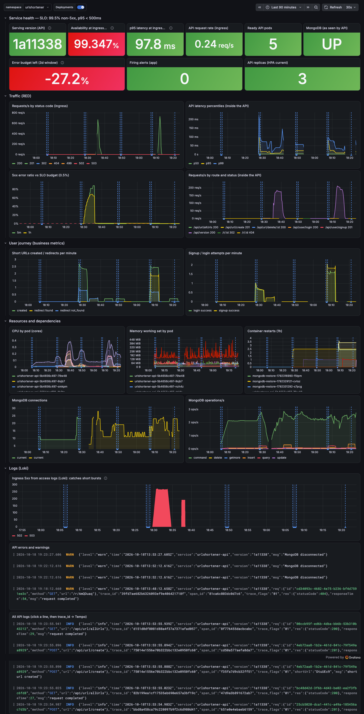

# URL Shortener: operated on Kubernetes

A personal MERN URL shortener (React + Express + MongoDB), taken from "runs on
my machine" to a system that is built, tested, scanned, deployed, observed and
recovered with the practices from the Advanced DevOps course.

- **Baseline:** [`12b426b`](https://github.com/TUSHAR1651/UrlShortner/tree/12b426b911f0fcad54f184c44ed0040f42bc9d2b), described in [docs/BASELINE.md](docs/BASELINE.md)
- **All changes:** one PR from `devops/production-readiness`
- **Environment:** local Kubernetes (kind). No cloud account or paid service is needed.

| Document | What it covers |
|---|---|
| [docs/BASELINE.md](docs/BASELINE.md) | Starting point, what already existed, defects found |
| [docs/ARCHITECTURE.md](docs/ARCHITECTURE.md) | Components, request path, commit → production path, failure boundaries |
| [docs/DECISIONS.md](docs/DECISIONS.md) | Every major choice, its alternatives, and when I'd choose differently |
| [docs/RUNBOOK.md](docs/RUNBOOK.md) | One section per alert: confirm, act, verify recovery |
| [docs/INVESTIGATIONS.md](docs/INVESTIGATIONS.md) | Real problems found by breaking the system: symptom → hypothesis → evidence → change → verification |
| [docs/evidence/](docs/evidence/README.md) | Raw outputs from the cluster for every claim below |



## What changed (summary)

| Area | Baseline | Now |
|---|---|---|
| App | Hard-coded config, crash on duplicate URL, unauthenticated URL API, password hash in JWT | Env-based config, health/readiness endpoints, graceful shutdown, Mongo reconnect, JWT auth with ownership checks, input validation, rate limiting, server-side `/r/:id` redirect, 15 integration tests (~93% coverage) |
| Containers | none | Multi-stage, non-root, read-only, digest-pinned images; 0 fixable HIGH/CRITICAL CVEs |
| Kubernetes | none | Helm chart: API Deployment + HPA + PDB, web Deployment, Mongo StatefulSet + PVC + exporter, backup CronJob, Ingress, NetworkPolicies, restricted Pod Security |
| Config | n/a | One chart, `environments/{local,ci,release}.yaml` overlays, pinned platform charts |
| CI/CD | none | GitHub Actions: lint, tests, audits, secret and config scans, image build and scan, **e2e deploy on kind incl. automatic-rollback test**, publish to GHCR with provenance |
| Release | none | Rolling update with zero unavailability, Helm `--rollback-on-failure`, `make rollback`, drift check, version traceable from commit to `/api/version` |
| Observability | `console.log` | Prometheus (RED, business, build info), SLOs at the ingress with burn-rate alerts and runbooks, Loki logs with trace ids, Tempo traces (Traefik → API → MongoDB), Grafana dashboard as code |
| Security | secret in source, 15 server vulns (3 critical) | Generated in-cluster secrets, least-privilege DB users, PSA restricted, default-deny network, 0 runtime-dependency vulns, gitleaks, Trivy, SHA-pinned actions |
| Data | none | Nightly `mongodump` to a separate volume, tested restore |

## Run it

### Prerequisites

| Tool | Version used | Notes |
|---|---|---|
| Docker | Desktop 29.x, **≥ 6 GB memory** for the VM | the full stack uses ~4 GB |
| kind | 0.33 | `brew install kind` |
| kubectl | 1.34+ | |
| Helm | **4.x** (4.3.1) | scripts use Helm 4 flags (`--rollback-on-failure`) |
| make, curl, openssl, python3 | any | preinstalled on macOS |
| Node.js | 24 | only for running tests outside Docker |
| Optional | trivy, hadolint, kubeconform, gitleaks, ab | `make lint`, `make scan`, autoscaling demo |

### From zero to a verified deployment

```bash
git clone https://github.com/TUSHAR1651/UrlShortner.git && cd UrlShortner
git checkout devops/production-readiness

make up        # = cluster + secrets + platform + build + deploy + smoke (~10 min the first time)
```

Or step by step:

```bash
make cluster    # kind cluster from deploy/kind/cluster.yaml
make secrets    # random credentials created inside the cluster (nothing on disk)
make platform   # Traefik, metrics-server, Prometheus/Alertmanager/Grafana, Loki, Alloy, Tempo
make build      # images tagged with the git SHA, loaded into kind
make deploy     # helm upgrade --rollback-on-failure, then helm test
make smoke      # signup → login → shorten → list → 302 redirect → delete, through the ingress
```

### Access

| What | Where |
|---|---|
| App | http://localhost:8080 (sign up, log in, shorten). Short links: `http://localhost:8080/r/<id>` |
| Deployed version | `curl -s localhost:8080/api/version` (API), `curl -s localhost:8080/version.json` (web) |
| Grafana | `make grafana` → http://localhost:3000, user `admin`, the password is printed (read from the cluster Secret). Dashboard: **URL Shortener — Service Overview** |
| Prometheus / alerts | `make prometheus` → http://localhost:9090/alerts |
| Logs / traces | Grafana → Explore → Loki `{namespace="urlshortener"}`; click a `trace_id` → Tempo |

Operator UIs are deliberately **not** exposed through the ingress.

### Day-2 operations

```bash
make status              # version, pods, HPA, PDB, PVC, Helm history
make rollback            # previous Helm revision (REVISION=n for a specific one), then smoke test
make drift               # live cluster vs the deployed release
make backup / restore    # run the backup now / restore newest archive
make verify              # prove security controls + observability on the live cluster
make evidence            # rebuild, redeploy, run every experiment, rewrite docs/evidence (~25 min)
make test lint scan      # the CI quality gates, locally
make down                # delete the cluster
```

Failure experiments you can run live: `scripts/demos/{bad-release,mongodb-outage,drift,node-drain,autoscale,backup-restore}.sh`.

### Local development without Kubernetes

```bash
docker run -d --name dev-mongo -p 27017:27017 mongo:8.0
cd server && npm ci && npm run dev        # API on :8000 (JWT_SECRET defaults to a dev value outside production)
cd client && npm ci && npm start          # UI on :3000, /api proxied to :8000
```

## CI/CD

`.github/workflows/ci.yml` runs on every PR and push to `main`:

```
api (lint, test, audit) ─┐                          ┌─ e2e on kind: deploy, helm test, smoke test,
web (test, build, audit) ┼─ images (build, Trivy) ──┤   drift check, broken release → auto-rollback
config (gitleaks, helm   │                          │
  lint, kubeconform,     └──────────────────────────┘
  hadolint, Trivy config)                              └─ publish (main only): GHCR :<sha>, provenance, chart
```

Deployment to the laptop cluster is a deliberate human step:
`make deploy-release TAG=<sha>` for an image from GHCR, or `make build deploy`.
GitHub's runners cannot reach a cluster behind NAT; see
[DECISIONS §6](docs/DECISIONS.md#6-cicd-and-the-automation-boundary) for why
this boundary and when I'd move to GitOps.

## Repository layout

```
server/                 Express API (+ Dockerfile, tests)
client/                 React app (+ Dockerfile, nginx.conf)
deploy/kind/            cluster definition
deploy/platform/        pinned values for Traefik, Prometheus stack, Loki, Tempo, Alloy, metrics-server
deploy/helm/urlshortener/  the application chart, environments/, Grafana dashboard JSON
scripts/                cluster, secrets, build, deploy, smoke, rollback, drift, restore, verify-*
scripts/demos/          repeatable failure experiments
.github/                CI pipeline, Dependabot
docs/                   baseline, architecture, decisions, runbook, investigations, evidence
```

## Known limitations

- **MongoDB is a single replica on node-local storage**, the main single point
  of failure: a DB outage means `/api` returns 503 (evidence 06), and the pod
  cannot move off its node. Production: replica set or managed DB
  ([DECISIONS §2](docs/DECISIONS.md#2-workload-types)).
- **`node_modules/` committed in the baseline is still tracked.** Removing
  41k files would bury the real changes in this PR's diff. It is excluded from
  Docker builds, CI uses `npm ci`, and scans skip it. Untracking it is a
  separate follow-up PR.
- **No TLS**: the ingress listens only on `127.0.0.1:8080`. Production:
  cert-manager.
- **CD stops at a human command** (cluster is not reachable from CI); there is
  one environment. GHCR packages are private by default: make them public or
  set `image.pullSecrets` before `make deploy-release`.
- **Retention is 3 days**, so the 30-day SLO window is approximated; the
  error-budget panel says so. Alertmanager has no real receiver (null route).
- **Rate limiting is per pod** (in-memory), so the effective limit is ×replicas.
- **Client** is Create React App (deprecated). Two moderate react-router
  advisories need the v7 migration; remaining audit findings are build-time
  tooling that never ships in the nginx image.
- **Docker Desktop quirks:** `kind load` fails for multi-arch images with the
  containerd image store (workaround: `docker save --platform` +
  `kind load image-archive`); image pulls can fail on IPv6, so retry.
