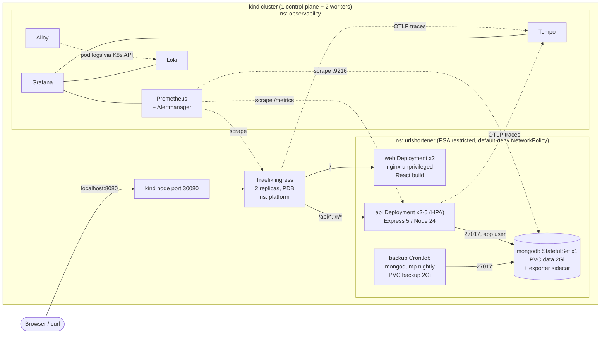
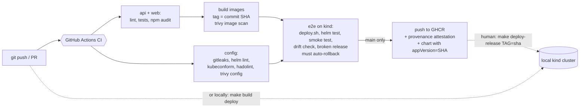

# Architecture

## Components

| Component | Kind | Why this kind |
|---|---|---|
| `api` | Deployment + HPA + PDB | Stateless (all state is in Mongo and the JWT), so any replica can serve any request and replicas can be added or removed freely |
| `web` | Deployment + PDB | Static files; nginx only, no backend calls from the pod |
| `mongodb` | StatefulSet (1 replica) + headless Service + PVC | Needs a stable network identity and a disk that follows the pod |
| `mongodb-backup` | CronJob | Run-to-completion work on a schedule |
| Traefik | Deployment (2) + NodePort Service | The single entry point; NodePort because kind has no cloud load balancer |

## The request path

Example: following a short link, `GET http://localhost:8080/r/Ab3dE9x`.

1. **Host → cluster.** kind maps `127.0.0.1:8080` on the laptop to NodePort
   `30080` on the control-plane container (`deploy/kind/cluster.yaml`).
   kube-proxy forwards it to one of the two Traefik pods.
2. **Traefik** matches the Ingress rule `/r` (Prefix) → Service
   `urlshortener-api:8000`. It starts the root trace span, adds a W3C
   `traceparent` header, and counts the request in
   `traefik_router_requests_total` (the SLI). Only *Ready* API endpoints are
   candidates. With none ready it returns 503 (`allowEmptyServices`) rather
   than falling through to the `/` route.
3. **NetworkPolicy** `urlshortener-api` allows ingress from the `platform`
   namespace on 8000. Everything else is denied by `urlshortener-default-deny`.
4. **API pod** (`server/app.js`): pino-http assigns or propagates
   `X-Request-Id`. The metrics middleware starts the latency timer, then
   helmet and the JSON parser run, then `GET /r/:id` → `redirect()` in
   `controllers/UrlController.js`.
5. **MongoDB**: `findOne({shortUrl})` over the app user's connection
   (`readWrite` on `Urls` only). The pod DNS name
   `urlshortener-mongodb-0.urlshortener-mongodb...` comes from the headless
   service. NetworkPolicy allows only API and backup pods to reach 27017.
6. **Response**: `302 Location: <long URL>`, or 404. pino writes one JSON log
   line with `trace_id`. The histogram and `urlshortener_redirects_total`
   are updated, and spans are exported to Tempo.

Creating a link adds JWT verification (`middleware/auth.js`): the user id comes
from the token, never from the request body.

## The change path: commit → running pods

1. A commit is pushed and CI runs (`.github/workflows/ci.yml`). Every gate must
   pass on the PR.
2. Images are built once, tagged with the 7-character commit SHA, and scanned.
   The **same image files** are loaded into the e2e cluster and, on `main`,
   pushed to GHCR. Nothing is rebuilt between test and publish.
3. Deployment is `scripts/deploy.sh <sha>`:
   `helm upgrade --install --rollback-on-failure --wait=watcher --force-conflicts`
   with the chart packaged as `appVersion=<sha>`, followed by `helm test`.
4. The rolling update (`maxSurge 1, maxUnavailable 0`) adds a new pod and waits
   for its readiness probe before removing an old one. If the new pods never
   become Ready, Helm restores the previous revision automatically.
5. The running version is traceable from four places that must agree: the image
   tag, the Helm revision's APP VERSION and description, the pod label
   `app.kubernetes.io/version`, and `GET /api/version` /
   `urlshortener_build_info{version,commit}`.

## Failure boundaries

| Failure | What users see | Why / mitigation | Evidence |
|---|---|---|---|
| One API pod crashes or hangs | Nothing | 2+ replicas; liveness restarts it; readiness removes it from endpoints; on restart the app drains before closing | 05 (crash-looping pod never served), 11 |
| Bad release (crash or failed probes) | No error responses | `maxUnavailable 0` + readiness: old pods keep serving; Helm rolls back | 05 |
| MongoDB down | `/api` and `/r` return 503; static UI still loads | API readiness depends on Mongo, so pods leave rotation; liveness does not, so no restart storm; reconnect is automatic | 06 |
| Node drain (planned) | Nothing | PDBs (api/web/traefik), topology spread, preStop and graceful drain | 07 |
| Node failure (unplanned) | Short blip for stateless parts; **outage if it is the Mongo node** | Mongo is a single replica on node-local storage, the main single point of failure (see DECISIONS.md) | — |
| Traffic spike | Higher latency until scale-out | HPA 2→5 on CPU | 08 |
| Data loss / corruption | Links missing | Nightly mongodump to a separate volume, tested restore | 09 |
| Observability stack down | Nothing (app unaffected) | Fully decoupled; tracing export failures are dropped, logs are read from the K8s API | — |
| Ingress pod lost | Nothing | 2 replicas spread across workers, PDB | 07 |
| Manual change in the cluster | Possibly nothing, until it matters | `drift-check.sh` in CI and on demand; redeploy restores state | 03 |
